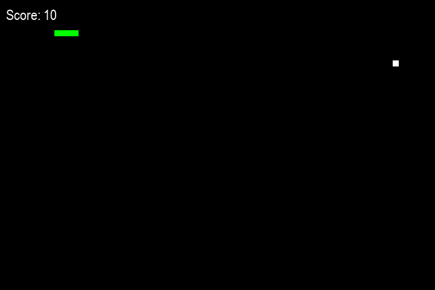

<div align="center">
  <h1>Snake-python</h1>
  <p><strong>A classic arcade game in Python and Pygame.</strong></p>
  <p></p>
</div>

Snake-python is a desktop implementation of the classic Snake game, written in Python with Pygame. Steer a growing snake around a grid, collect fruit, and try to beat your previous score.

## Preview



[Watch the gameplay GIF](snake%20game/snake-pythonn.gif) · [View the recorded playthrough](snake%20game/snake-python.mp4)

## How to play

- **Space** starts the game from the title screen.
- **Arrow keys** steer the snake. Each fruit adds ten points and grows the snake.
- Hitting a wall or the snake’s body ends the run.
- **R** returns to the title screen after a collision. **Q** quits from the game-over screen.

## Getting started

Use Python 3 with a graphical desktop. From the repository root:

```sh
python -m pip install pygame
python "snake game/snake.py"
```

The original Python fundamentals exercise is preserved in [exercises/learnOne.py](exercises/learnOne.py).

## Credits

Built by Hastixie Studio with [Pygame](https://www.pygame.org/). The Python icon is from [Devicon](https://github.com/devicons/devicon).

---
<div align="center">
  
  <p>Made with 💚 by <strong>Hastixie Studio</strong></p>
  <p>
    <a href="https://github.com/HastiKabiri"></a>
    &nbsp;
    <a href="https://www.linkedin.com/in/hasti-kabiri-717551306/"></a>
  </p>
  <sub>© 2026 Hastixie Studio</sub>
</div>
